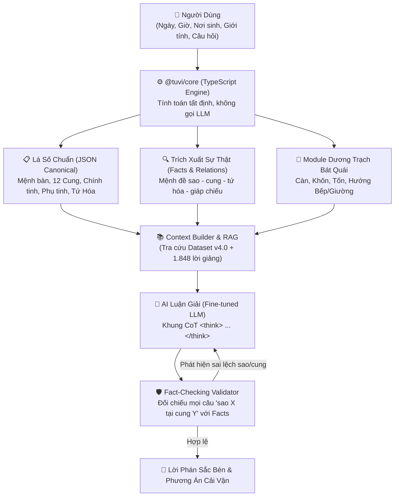

# 🌌 Tử Vi Đẩu Số AI — Hệ Phái Thiên Kỷ (Nghê Hải Hạ)
### *Hệ Thống Lập Lá Số Tất Định & Trí Tuệ Nhân Tạo Luận Giải Tử Vi Chuyên Sâu*

[](LICENSE.md)
[](#-lõi-lập-lá-số-tất-định-tuvicore)
[-green.svg)](#-bộ-dữ-liệu-dataset-v40)
[](#-ngữ-liệu-và-tài-liệu-bài-giảng-tiếng-việt)
[](#)

---

## 📖 1. Giới Thiệu Tổng Quan

Dự án **Tử Vi Đẩu Số AI — Hệ Phái Thiên Kỷ** là nền tảng mã nguồn mở toàn diện kết hợp giữa:
1. **Động cơ lập lá số tất định (`tuvi-core`):** Tính toán an sao, tứ hóa, can chi, giờ mặt trời thực chuẩn xác 100% bằng code TypeScript, tuyệt đối không giao việc tính toán an sao cho LLM để tránh ảo giác (*hallucination*).
2. **Kho ngữ liệu kinh điển Thầy Nghê Hải Hạ:** Gồm **1.848 câu khẩu quyết, luận giải thực chiến** từ 16 bài giảng khóa học 《Thiên Kỷ》, được dịch chuẩn thuật ngữ Hán - Việt và gắn mốc thời gian video Bilibili gốc chính xác đến từng giây.
3. **Cơ sở dữ liệu mẫu quy mô lớn (Dataset v4.0):** Bao phủ **674.976 lá số** (toàn bộ ngày dương lịch từ năm 1950 đến 2026 × 12 giờ × nam/nữ) với 13 chiều phân tích chuẩn tắc.
4. **Kiến trúc AI Luận Giải:** Tách đôi kiến trúc (Code lập lá số $\rightarrow$ Trích xuất Sự thật `Facts` $\rightarrow$ LLM suy luận đa tầng với cơ chế Chain-of-Thought `<think>` $\rightarrow$ Bộ kiểm định Validator đối chiếu lá số).

---

## 🏛️ 2. Triết Lý Cốt Lõi Hệ Phái Thiên Kỷ

Hệ thống kế thừa trọn vẹn phương pháp luận của Đại sư **Nghê Hải Hạ (Ni Haixia, 倪海厦, 1954 – 2012)**:

* **Công Thức Tam Tài $\text{Thiên} + \text{Địa} + \text{Nhân} = 1$:**
  $$\text{Thiên Mệnh } \left(\frac{1}{3}\right) + \text{Địa Lý } \left(\frac{1}{3}\right) + \text{Nhân Đạo } \left(\frac{1}{3}\right) = 1$$
  Thiên mệnh xấu ($1/3$), nếu dùng **Địa Lý Dương trạch Bát Quái ($1/3$)** kết hợp với **Nhân đạo / Hành vi tu dưỡng ($1/3$)** thì ta có $2/3$ sức mạnh để chuyển hóa và thắng thiên mệnh ($2/3 > 1/3$).
* **Dĩ Quả Quyết Hành & Đàm Quả Bất Đàm Nhân:** Luận giải thẳng vào kết quả để định hướng hành động dứt khoát; kiên quyết bài trừ cúng bái bùa chú mê tín dị đoan.
* **Đoán Thần Không Đoán Hình:** Trọng thần thái, khí sắc, linh cơ hơn là rập khuôn máy móc theo sách vở.
* **Mệnh Tướng Đồng Tham:** Đối chiếu lá số với Tam đình, Ngũ quan, Khí sắc và Lục Thần tướng pháp (Thanh Long, Bạch Hổ, Huyền Vũ, Câu Trần, Đằng Xà).

---

## 🏗️ 3. Kiến Trúc Hệ Thống (Compound AI Architecture)

Triết lý cốt lõi: **"Tách đôi kiến trúc: code lập lá số, model chỉ luận giải"**.



---

## 📂 4. Cấu Trúc Thư Mục Repository

```tree
fortune-telling/
├── README.md                                           <-- File tài liệu trung tâm của repository
├── .gitignore                                          <-- Chặn triệt để cache, file nén zip/tar và dataset nặng
├── Tách đôi kiến trúc code lập lá số, model chỉ luận giải.docx <-- Chuyên luận kiến trúc hệ thống
│
├── Việt Nam/
│   ├── tuvi-core/                                      <-- PACKAGE LÕI: Lõi lập lá số TypeScript (@tuvi/core)
│   │   ├── package.json                                <-- Quản lý dependencies (iztro, astronomy-engine, lunar-javascript)
│   │   ├── tsconfig.json                               <-- Cấu hình TypeScript compiler
│   │   ├── src/
│   │   │   ├── index.ts                                <-- Entrypoint public API của engine
│   │   │   ├── cli.ts                                  <-- Giao diện dòng lệnh CLI (tuvi chart, tuvi batch...)
│   │   │   ├── natal.ts                                <-- Thuật toán an sao và tính lá số bản mệnh
│   │   │   ├── facts.ts                                <-- Trích xuất sự thật cấu trúc (Facts & Relations) cho LLM
│   │   │   ├── profiles.ts                             <-- Quản lý các cấu hình trường phái (repro-v4, thienky-candidate)
│   │   │   ├── normalize.ts                            <-- Chuẩn hóa ngày giờ sinh, dương lịch, âm lịch, ranh giờ, blocked audit
│   │   │   ├── timezone.ts & calendar.ts               <-- Xử lý múi giờ và thiên văn
│   │   │   ├── canonical.ts                            <-- Băm và xuất JSON chuẩn tắc (deterministic hash)
│   │   │   └── i18n.ts                                 <-- Bản địa hóa tiếng Việt Hán - Việt
│   │   ├── i18n/
│   │   │   └── vi.json                                 <-- Từ điển thuật ngữ Tử Vi Hán - Việt chuẩn xác
│   │   ├── scripts/
│   │   │   ├── compare-v4.ts                           <-- Script đối chiếu lá số với Dataset v4.0
│   │   │   ├── calendar-diff.ts                        <-- Script kiểm thử sai lệch lịch thiên văn 1950-2026
│   │   │   └── verify-vendor.cjs                       <-- Kiểm tra tính toàn vẹn mã nguồn vendor
│   │   ├── examples/                                   <-- Các file mẫu đầu vào (birth.json, batch.jsonl...)
│   │   ├── tests/                                      <-- Bộ test tự động 49/49 tests (natal, facts, normalize, vietnamese-adapter...)
│   │   └── vendor/                                     <-- Mã nguồn thuật toán gốc và bảng an sao
│   │
│   ├── tuvi-web/                                       <-- FRONTEND & ADAPTER: Giao diện web Tử Vi Vũ Trụ
│   │   ├── server.js                                   <-- Máy chủ Node.js REST API & static server bảo mật
│   │   ├── package.json                                <-- Quản lý phụ thuộc và scripts chạy web/test
│   │   ├── tests/                                      <-- Bộ test tích hợp và kiểm thử giao diện 32/32 tests
│   │   └── public/                                     <-- Giao diện 3 màn hình SPA (Cosmic Portal, Bàn cờ 4x4, Dữ kiện)
│   │       ├── index.html                              <-- Khung HTML chính, hỗ trợ nhập ngày giờ, mở file JSON
│   │       ├── css/styles.css                          <-- Hệ thống style Cosmic Theme, Glassmorphism, Responsive
│   │       ├── assets/                                 <-- Nền vũ trụ Cosmic 4K, vòng thiên thể Astrolabe Mandala
│   │       └── js/                                     <-- Module JS ES (app, chart, form, details, reading, verification...)
│   │
│   ├── docs tiếng việt/                                <-- 16 FILE BÀI GIẢNG DỊCH THUẬT NGUYÊN BẢN CỦA THẦY NGHÊ
│   │   ├── README.md & LICENSE.md                      <-- Mục lục và giấy phép CC BY-NC-SA 4.0
│   │   ├── Bài 02 Thượng.md -> Bài 15 Thượng.md        <-- 14 bài giảng chính Tử Vi Đẩu Số (1.808 câu)
│   │   ├── Bài 19 Thượng_Bổ sung 1.md                  <-- Bổ sung phong thủy, Đẩu Quân, Lưu nguyệt lưu nhật (29 câu)
│   │   └── Bài 24 Hạ_Bổ sung 2.md                      <-- Bổ sung tướng pháp đồ tể, Khoa Lộc phùng Kỵ (11 câu)
│   │
│   ├── Tong_Hop_Loi_Giang_Tu_Vi_Dau_So_Nghe_Hai_Ha.docx <-- File Word tổng hợp trọn bộ 1.848 câu giảng & link Bilibili
│   ├── Phuong_Phap_Luan_Tu_Vi_Dau_So_Nghe_Hai_Ha.docx   <-- Chuyên luận phương pháp luận Thiên Kỷ (Bản Word)
│   └── Phuong_Phap_Luan_Tu_Vi_Dau_So_Nghe_Hai_Ha.md     <-- Chuyên luận phương pháp luận Thiên Kỷ (Bản Markdown)
│
└── China/
    └── docs/                                           <-- Ngữ liệu đối chiếu tiếng Trung gốc từ repo tác giả
        ├── tianji-ziwei/                               <-- 16 file markdown bài giảng tiếng Trung
        ├── entries.jsonl                               <-- 1.848 bản ghi JSONL có mốc thời gian
        └── overview.png                                <-- Sơ đồ tổng quan khóa học Thiên Kỷ
```

---

## ⚡ 5. Hướng Dẫn Sử Dụng Lõi Lập Lá Số (`@tuvi/core`)

Lõi lập lá số nằm tại thư mục `Việt Nam/tuvi-core`, được viết hoàn toàn bằng TypeScript hiện đại, tương thích Node.js (khuyên dùng Node.js $\ge 20$ hoặc $24$):

### Cài đặt và biên dịch:
```bash
cd "Việt Nam/tuvi-core"

# 1. Cài đặt thư viện phụ thuộc
npm install

# 2. Biên dịch mã nguồn TypeScript ra JavaScript
npm run build

# 3. Chạy toàn bộ bài kiểm thử tự động
npm test
```

### Sử dụng giao diện dòng lệnh (CLI):
```bash
# Xem danh sách các profile trường phái hỗ trợ:
node dist/src/cli.js profiles

# Lập lá số từ file JSON đầu vào (chuẩn hóa ngày giờ sinh):
node dist/src/cli.js chart --input examples/birth.json --profile thienky-candidate

# Lập lá số theo profile đối chiếu Dataset v4:
node dist/src/cli.js chart --input examples/chart-ready.json --profile repro-v4

# Lập lá số hàng loạt từ file batch JSONL:
node dist/src/cli.js batch --input examples/batch.jsonl --output results.jsonl --profile repro-v4
```

### Sử dụng làm thư viện trong mã nguồn TypeScript / Node.js:
```typescript
import { computeNatal, decorateNatal, getProfile } from './src';

// 1. Tính toán lá số bản mệnh tất định (kèm facts, labels, relations, hash)
const result = computeNatal(
  {
    year: 1990,
    month: 8,
    day: 15,
    hourBranch: 6, // Chi giờ Ngọ (0 = Tý .. 11 = Hợi)
    gender: 'male',
  },
  getProfile('thienky-candidate'),
);

// 2. Sự thật cấu trúc (Facts) phục vụ LLM Validator
const { facts } = result;

// 3. Bản địa hóa Hán - Việt để hiển thị
const localizedChart = decorateNatal(result.natal);
console.log(JSON.stringify({ factsCount: facts.length, localizedChart }, null, 2));
```

### Khởi chạy Giao diện Trực quan (`tuvi-web`):
Giao diện web phong cách Vũ Trụ Sâu Thẳm (Cosmic Deep Space), tích hợp bàn cờ 4×4 tương tác, màn hình dữ kiện cấu trúc và hỗ trợ nhập trực tiếp hoặc mở file JSON:
```bash
cd "Việt Nam/tuvi-web"

# 1. Chạy bài kiểm thử giao diện & API (32/32 tests passed)
npm test

# 2. Khởi chạy máy chủ web local
npm start
# -> Mở trình duyệt tại: http://localhost:3000
```

---

## 📊 6. Bộ Dữ Liệu Dataset v4.0 & Cơ Chế Đối Chiếu

* **Quy mô:** **674.976 lá số**, bao phủ trọn vẹn từ năm 1950 đến 2026 × 12 canh giờ × 2 giới tính.
* **Bản chất kỹ thuật:** Dữ liệu sinh tất định bằng engine luật mẫu (Rule-based Templates), dung lượng nén `.zst` là **161 MB** (bung thô nở thành **~56.6 GB** text).
* **Quy tắc quản lý trên Git:** Toàn bộ các file nén nặng (`*.zst`, `*.tar`, `ziwei-interp-v4-all/`) đã được cấu hình tự động loại bỏ trong `.gitignore` để giữ repository luôn nhẹ nhàng và tải nhanh.
* **Công cụ đối chiếu sẵn có trong package:**
  ```bash
  # Chạy script đối chiếu kiểm chứng độ khớp cấu trúc với Dataset v4 (không cần giải nén 57 GB):
  npm run compare:v4
  ```

---

## 🤖 7. Lộ Trình Huấn Luyện AI (Model Training Roadmap)

Dự án phát triển mô hình AI chuyên gia Tử Vi dựa trên 4 giai đoạn kỹ thuật:

1. **Giai đoạn 1: Chuẩn bị Dữ liệu Huấn Luyện (Data Pipeline)**
   * Không nạp bừa bãi 57 GB text thô.
   * Trích xuất **Kho câu phân tích độc nhất (Unique Template Phrases)** từ Dataset v4.0 và dịch đồng bộ sang thuật ngữ Hán - Việt.
   * Lọc lấy **6.000 – 10.000 mẫu lá số đại diện** theo độ phủ cách cục (đầy đủ các chính tinh, tứ hóa, thế đứng giáp chiếu, cách cục hiếm và ca biên giờ Tý).
2. **Giai đoạn 2: Tạo Chuỗi Tư Duy CoT (Reasoning Distillation)**
   * Sử dụng khung CoT bắt buộc trong thẻ `<think>`:
     `Quét Mệnh/Thân` $\rightarrow$ `Xét Ngũ Hành Cục` $\rightarrow$ `Kiểm tra Cung Phúc Đức` $\rightarrow$ `Quét Tứ Hóa & Xung Chiếu` $\rightarrow$ `Đối chiếu Bát Quái Dương Trạch` $\rightarrow$ `Đúc kết Dĩ Quả Quyết Hành`.
3. **Giai đoạn 3: Huấn luyện SFT & DPO trên Cloud GPU**
   * **Base Model đề xuất:** `Qwen2.5-14B-Instruct` hoặc `Qwen2.5-32B-Instruct` (mô hình nguồn mở đứng đầu về ngữ nghĩa Hán ngữ và phương Đông).
   * **Phương pháp:** QLoRA 4-bit ($r=32\text{--}64, \alpha=64$, context 8k, bật packing).
   * **Cặp dữ liệu DPO:** `Chosen` (chuẩn quy tắc lá số, đanh thép đúng phong cách Thầy Nghê, hướng dẫn cải vận bằng phong thủy/đạo đức) vs `Rejected` (phán đoán sai vị trí sao, nước đôi chung chung, khuyên cúng bái bùa chú).
4. **Giai đoạn 4: Đóng gói & Tích hợp Ứng Dụng**
   * Xuất file LoRA adapter / GGUF để chạy offline trên Ollama / vLLM.
   * Kết nối với giao diện Web/App thông qua API của `tuvi-core`.

---

## ⚖️ 8. Giấy Phép & Bản Quyền (License)

Dự án áp dụng mô hình phân tách giấy phép hai nhánh nghiêm ngặt:

1. **Nhánh Phi Thương Mại (Non-Commercial):**
   * Toàn bộ 1.848 câu khẩu quyết, trích dẫn bài giảng của Thầy Nghê Hải Hạ trong `Việt Nam/docs tiếng việt/` và các tài liệu phái sinh dịch thuật tuân thủ giấy phép **[CC BY-NC-SA 4.0](https://creativecommons.org/licenses/by-nc-sa/4.0/deed.vi)**.
   * Bản quyền nội dung gốc thuộc về **Thầy Nghê Hải Hạ và những người thừa kế quyền hợp pháp**. Tuyệt đối không dùng nhánh dữ liệu này vào mục đích thương mại khi chưa có sự đồng ý.
2. **Nhánh Kỹ Thuật & Mã Nguồn (Open-Source):**
   * Gói mã nguồn `@tuvi/core`, các thuật toán an sao, scripts kiểm thử và công cụ CLI tuân thủ giấy phép **[MIT License](LICENSE.md)**.

---

## ⚠️ 9. Tuyên Bố Miễn Trừ Trách Nhiệm (Disclaimer)

* Toàn bộ tài liệu, công thức và mã nguồn trong kho lưu trữ này phục vụ cho mục đích nghiên cứu học thuật, bảo tồn văn hóa truyền thống Á Đông và thử nghiệm kỹ thuật Trí Tuệ Nhân Tạo (AI).
* Mọi nội dung phân tích liên quan đến bệnh tật (Tý Ngọ lưu chú), hôn nhân hay tài lộc **tuyệt đối không cấu thành lời khuyên y tế, pháp lý, tài chính đầu tư hay quyết định sinh mệnh cá nhân**. Người sử dụng phải tự chịu trách nhiệm về mọi hành vi và quyết định của bản thân trong đời sống thực tế.
